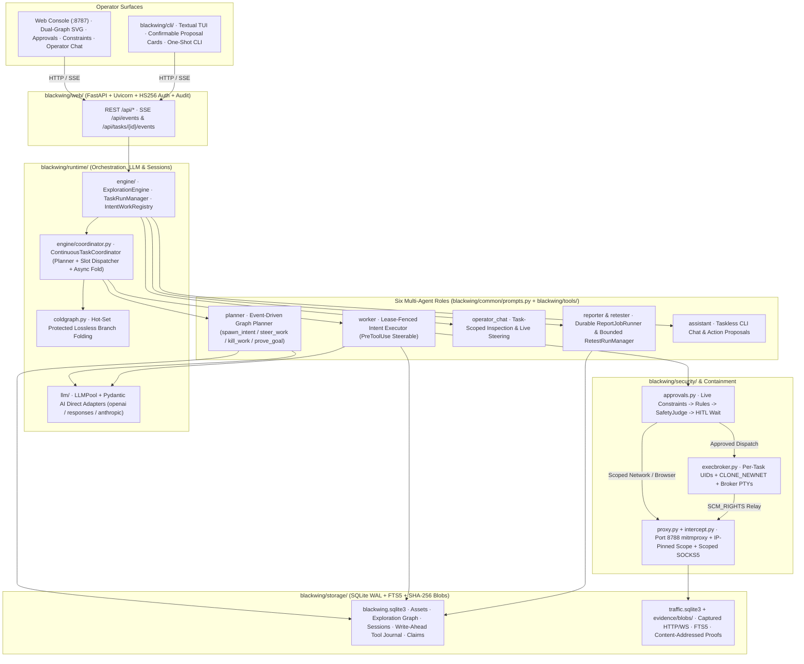
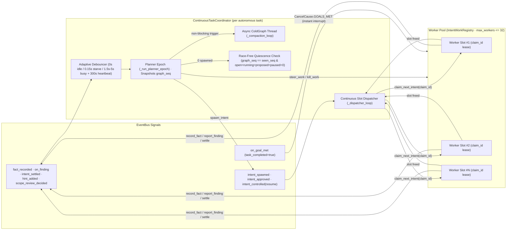
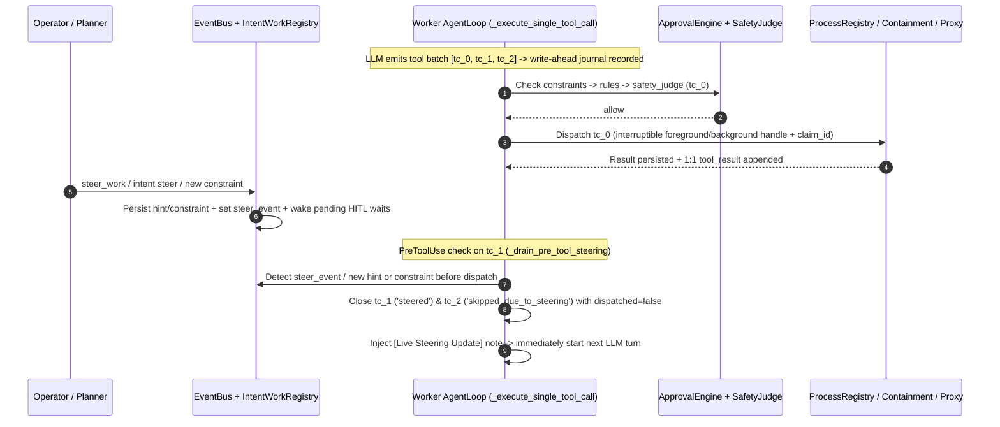
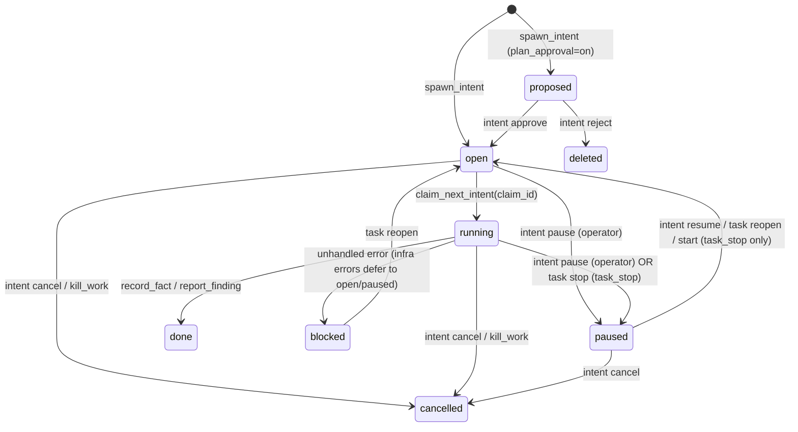
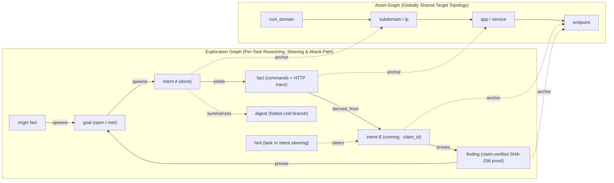

# BLACKWING

**Autonomous Multi-Agent Security Assessment & Reconnaissance Platform**

FastAPI + SSE · SQLite (WAL + FTS5) · Local-First AI · Dual-Graph Architecture · Kernel-Contained Execution · HITL

> **Source is private. Code walkthrough available on request.**
> This repository is a showcase: architecture, design decisions, and a few unedited code excerpts.

---

## What It Is

Blackwing runs teams of LLM agents that plan and carry out security assessments against targets an operator is authorized to test. The hard problem is not getting agents to act; it is keeping them inside scope, stopping them from approving their own risky actions, and proving every finding with evidence a human can check. Blackwing is built around those three guarantees.

## Demo

A short video walkthrough is coming soon.

---

## Highlights

* **Multi agent orchestration.** A planner breaks a goal into intents, and parallel workers claim and execute them with tool calls (shell, browser, HTTP, MCP). An event driven coordinator keeps workers busy without one slow worker blocking the rest, and every intent can be paused, steered, or cancelled live.
* **One LLM engine, many providers.** Pydantic AI adapters for Anthropic, OpenAI, and local OpenAI compatible models (Ollama, vLLM, LM Studio), with pooled retries, a shared per turn deadline, health cooldowns, and failover chains between model profiles.
* **Guardrails agents cannot talk their way past.** Every tool call passes through live operator constraints, deterministic rules, and an isolated LLM safety judge before anything runs. The judge never sees untrusted target data, accepts only a strict JSON verdict, and fails closed to human approval.
* **Scope is operator only.** Approving an action never widens scope, and no agent has a tool that changes it. Blocked requests become review cards that a human decides, with an audit trail.
* **Evidence backed findings.** A finding must list its claims, and every claim must cite captured traffic or a verification report. Each link is rechecked by SHA-256 hash every time the finding is read.
* **Contained execution.** On Linux, agent processes run under per task user IDs inside network namespaces that can reach only a scoped capture proxy.
* **Operator surfaces.** A FastAPI REST and SSE API, a live web console with an interactive graph and approvals drawer, and a terminal UI, all showing each agent's tool calls, LLM calls, and approvals.
* **Crash safe.** A write ahead journal records every tool call before it runs, so interrupted runs recover cleanly.

---

## Architecture

### Layered Runtime Architecture

Blackwing is built in layers, and each layer only talks to the one below it.

* **Operator surfaces.** The web console and the terminal UI are both clients of the same API, so anything an operator can do in one they can do in the other. Neither reaches into the engine directly.
* **Web layer (`blackwing/web/`).** FastAPI serves the REST API and streams live activity over Server Sent Events. Requests are authenticated, and operator actions are written to an audit log.
* **Runtime (`blackwing/runtime/`).** The `ExplorationEngine` owns task runs. For autonomous runs it hands control to the `ContinuousTaskCoordinator`, which drives the planner, the workers, and graph compaction. Every model call goes through `LLMPool`, which handles retries, deadlines, and failover across providers through Pydantic AI adapters. `ColdGraph` folds finished branches into summaries so long runs fit in the model's context window.
* **Agent roles.** Six roles share one agent loop but get different prompts and tool sets (table below). The planner and workers carry out the assessment, the reporter and retester handle findings, and `operator_chat` and `assistant` talk to the operator.
* **Security layer (`blackwing/security/`).** Workers never execute anything directly. Every call goes through `approvals.py` first. Only approved calls reach the execution broker, which runs processes under per task user IDs in an isolated network namespace, or the capture proxy, which enforces task scope on every request. The broker's only route to the network is a socket relay into that proxy.
* **Storage (`blackwing/storage/`).** Two SQLite databases. `blackwing.sqlite3` holds the graphs, agent sessions, the write ahead tool journal, and finding claims. `traffic.sqlite3` holds every captured request and response, searchable with FTS5, alongside evidence files named by their SHA-256 hash.

The most important design choice is visible in the arrows: a worker's only path to a target runs through the approval engine and then through containment. No edge lets an agent reach the network while skipping both.

### Agent Roles

| Role | What it does |
| --- | --- |
| `planner` | Reads the exploration graph, dispatches new intents while filtering duplicates, steers or cancels running intents, and marks goals met. |
| `worker` | Claims one intent under a unique lease, carries it out with tools, responds to live steering, and records assets, facts, and findings. |
| `reporter` | Writes the report for a confirmed finding. |
| `retester` | Checks whether a confirmed finding has been fixed. |
| `operator_chat` | Chat attached to one task. Inspects state and steers workers; it has no shell, network, or browser tools. |
| `assistant` | General chat outside any task. Looks things up and proposes actions for the operator to confirm. |

Every role runs the same bounded LLM and tool loop with its own prompt, its own filtered tool set, and its own model failover chain. A separate `safety_judge` model binding reviews risky calls but never runs an agent loop.

---

## Execution and Control Workflows

### 1. Autonomous Event-Driven Scheduling vs Single-Round Mode

Blackwing can run a task two ways.

* **Single round (`run`).** One planner pass, then the workers finish the open intents, then compaction. It stops after that round, so an operator can review each step before starting the next.
* **Autonomous (`start`).** The `ContinuousTaskCoordinator` splits the round into three loops that run independently:
  * **Planner epochs.** The planner wakes on events (a fact recorded, a finding, an intent settled, an operator hint, a scope decision) instead of on a fixed timer. An adaptive debouncer batches bursts of events: it plans right away when idle, after 0.15 seconds when workers are starved for work, and after 1.5 to 5 seconds when busy, with a 300 second heartbeat as a backstop.
  * **Slot dispatcher.** Up to `max_workers` worker slots (at most 32). When a worker finishes, its slot is refilled from the queue immediately, so a fast worker never waits for a slow sibling to finish a round.
  * **Compaction.** Graph folding runs on its own thread and never blocks planning.
* **Stopping.** The run ends when the planner spawns nothing new and a race free check confirms the graph has not changed since the planner last looked (`graph_seq == seen_seq`) and no intent is open, running, proposed, or paused. When a goal is proved, every running worker is interrupted at once.

### 2. Per-Tool Gate & `PreToolUse` Steering Interception

This is what happens inside a worker for every tool call.

1. The model returns a batch of tool calls. Before any of them runs, each is written to a write ahead journal (`agent_tool_operations`), so a crash in the middle of a batch still leaves a record of what was about to happen.
2. Each call passes the approval gate (see [Guardrails](#guardrails-how-a-tool-call-is-gated)) and then runs as an interruptible process tied to the worker's intent lease.
3. Between calls, the worker checks for steering. If the operator or planner sent new guidance or a new constraint while the batch was running, the remaining calls are closed without running (`steered` and `skipped_due_to_steering`), and the worker starts a fresh model turn with the update. Guidance takes effect before the next action, not after the whole batch.

### 3. Intent Lifecycle & Per-Intent Control

Every intent moves through a fixed set of states.

* With plan approval turned on, new intents start as `proposed` and wait for an operator to approve or reject them. Otherwise they start as `open`.
* A worker takes an `open` intent by claiming it with a unique `claim_id` lease. Fact and finding writes are fenced by that lease, so a worker that was cancelled or timed out cannot change the graph or report a late finding once its lease is revoked.
* An operator can pause, resume, or cancel any single intent without stopping the others.
* Pauses remember who caused them. An operator pause holds until the operator resumes it, while a pause caused by stopping the task reopens automatically when the task restarts.
* Failures are split by cause: an unhandled error marks the intent `blocked`, while infrastructure errors send it back to `open` or `paused` so it is retried instead of lost.

---

## Guardrails: How a Tool Call Is Gated

Every tool call an agent makes is checked in this order. A denial at any step stops the call.

1. **Live operator constraints** (always first). Typed rules such as `tool:`, `host:`, `method:` or plain directives such as "read only" or "no browser". Enforced even when approvals are turned off.
2. **Deterministic approval rules.** Priority ordered, task rules before global rules, and `deny` beats `ask` beats `allow`. Destructive shell commands and HTTP `DELETE` require approval by default.
3. **Reusable intent grants.** An operator can approve a tool once for the rest of an intent. Denies above always win over a grant.
4. **Isolated LLM safety judge** (on by default). Reviews high risk calls that no rule covered. It receives only the tool name, the canonical arguments, and the operator's own goal and constraints; never target responses, captured traffic, or agent reasoning, which shuts out prompt injection from the target. Its reply must be a strict JSON object (duplicate keys and invalid constants are rejected), and any error, timeout, or malformed verdict fails closed to human approval.
5. **Human approval.** The request waits in the approvals drawer. "Approve once" is bound to the exact task, intent, tool, and argument hash, and is consumed atomically.

Live steering runs alongside this gate: before each queued tool call, the worker checks for new operator guidance, and if any arrived it skips the rest of the batch and starts a fresh model turn with the update.

### Scope Reviews

Approving an action never widens task scope, and agents have no tool that changes it. When a tool or the capture proxy blocks a request for being out of scope, Blackwing records it, opens one review card per host, and tells the agent not to retry. Each card shows the exact entry to add, a wider option, and an advisory recommendation from the safety judge, which sees only the goal, the scope, and the host name and cannot approve anything. An authenticated operator decides with a reason; the decision is written to the audit log with the before and after scope, and the blocked action is not replayed automatically.

---

## Evidence: Every Claim Is Checked

A finding cannot be marked confirmed on an agent's word. It must list its material claims, and each claim must link to specific saved artifacts: a captured HTTP exchange (request, response, or both) bound to the finding, or a saved verification report.

Every time a finding is read, each link is rechecked in order:

| Check | Fails as |
| --- | --- |
| The cited artifact still exists | `missing` |
| It belongs to the same task as the finding | `wrong_task` |
| Its stored hash matches the hash recorded when it was cited | `hash_mismatch` |
| The bytes on disk still hash to that value | `hash_mismatch` / `missing` |

Claims appear beside their evidence in the console, the CLI, the API, and exported reports, so a reviewer can see exactly which captured response supports which sentence. See [`samples/claim_verification.py`](samples/claim_verification.py).

### Dual-Graph Data Model

Blackwing keeps two graphs and links them.

* **Exploration graph (per task).** Records why each step happened. An origin fact spawns a goal, the goal spawns intents, intents yield facts, facts lead to new intents, and an intent that proves something produces a finding, which in turn proves the goal. Operator hints attach to the intent they steer. This is both the agents' working memory and the audit trail behind every conclusion.
* **Asset graph (shared across tasks).** Records what exists on the target: root domains, subdomains and IPs, apps and services, and endpoints.
* **Anchors** tie the two together, so every intent, fact, and finding points at the exact asset it concerns.
* **Digests** keep long runs manageable. When a branch goes cold, `ColdGraph` folds it into one summary node for the planner, while the full records stay in the database.

---

## Tech Stack

| Area | Tools |
| --- | --- |
| Language | Python 3.12 (about 60,000 lines) |
| API and UI | FastAPI, Uvicorn, Server Sent Events, single file web console, Textual terminal UI |
| LLM | Pydantic AI adapters for Anthropic, OpenAI, and OpenAI compatible local models; MCP servers over HTTP and stdio |
| Storage | SQLite (WAL, FTS5 full text search), content addressed SHA-256 evidence blobs, schema migrations, online backups |
| Capture and browsing | mitmproxy, Playwright (Chromium) |
| Containment | Linux network namespaces, per task UIDs, dropped container capabilities |
| Deployment | Docker, Docker Compose |
| Quality | unittest, ruff, mypy, vulture, GitHub Actions |

## Testing and CI

**744 automated tests.** GitHub Actions runs three jobs on every push and pull request:

* **Runtime checks** on Ubuntu and Windows: ruff lint, mypy type checks, vulture dead code checks, and the full test suite.
* **Live integration** on Linux: real mitmproxy and Chromium HTTPS interception tests.
* **Container smoke test**: builds the image, starts it with all Linux capabilities dropped except a short allowlist, then verifies the server runs as a non root user, the tools account cannot read server secrets, network isolation reports as enforced, and the execution broker's command and terminal lifecycle works end to end.

A separate stress harness exercises concurrency and capture pressure.

---

## Code Samples

Unedited excerpts from the private source (imports omitted, so they do not run on their own):

| File | What it shows |
| --- | --- |
| [`samples/approval_gate.py`](samples/approval_gate.py) | The full per call gate, including the safety judge's strict JSON parsing and fail closed behavior |
| [`samples/claim_verification.py`](samples/claim_verification.py) | Claim validation at report time and SHA-256 link verification on every read |
| [`samples/llm_failover.py`](samples/llm_failover.py) | One model turn across a failover chain with health cooldowns, a shared deadline, and jittered backoff |
| [`samples/agent_request.py`](samples/agent_request.py) | How an agent's turn reaches a cloud model through Pydantic AI: an HTTPS check before any key is sent, only the profile's own key on the wire, per provider settings (Anthropic prompt caching, OpenAI Responses with storage off), and a streamed request that is cancelled cleanly on cancel or deadline |

---

## License and Authorized Use

Copyright (c) 2026 softdyne. All rights reserved. This repository is shared for review only; see [LICENSE](LICENSE).

Blackwing is intended solely for authorized security assessments, local technical verification, and educational research. Testing any target requires explicit written authorization from its owner.
